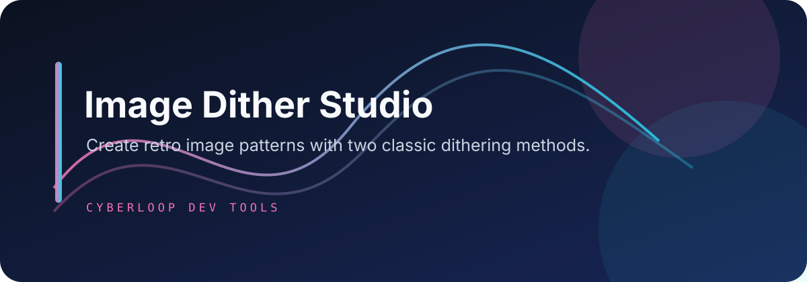

<div align="center">


<a href="https://github.com/CyberLoop-dev/image-dither-studio">

</a>

<p><strong>Apply classic dithering algorithms to local images and export the result as a PNG.</strong></p>

[](LICENSE)
[](https://github.com/CyberLoop-dev/image-dither-studio)
[](https://github.com/CyberLoop-dev/image-dither-studio/stargazers)
[](https://github.com/CyberLoop-dev/image-dither-studio/commits/main)



</div>

## ✨ Overview

Apply classic dithering algorithms to local images and export the result as a PNG. **Image Dither Studio** is a small, focused Node.js and browser JavaScript project. It runs locally, keeps user data in the browser, and is designed to be easy to inspect and extend.

## 🚀 Features

- ✨ 🖼️ Load an image directly into the browser canvas.
- ✨ 🧮 Apply Floyd–Steinberg error diffusion or ordered Bayer 4×4 dithering.
- ✨ 🎚️ Adjust output color levels from 2 to 8.
- ✨ 📥 Export the processed image as PNG without uploading it.

## 🖥️ Demo

Run `npm start`, open `http://127.0.0.1:4173`, and use the controls in the page. Choose a local image, switch between the two algorithms, adjust the levels, and export the canvas.

## ⚡ Quick Start

```bash
npm start
```

No third-party npm packages are required.

## 🧰 Tech Stack

- **Runtime:** Node.js (built-in HTTP server)
- **Frontend:** HTML, CSS, browser JavaScript
- **Dependencies:** None

## 📁 Folder Structure

```text
image-dither-studio/
├── assets/overview.svg
├── public/index.html
├── server.js
├── package.json
├── .gitignore
├── LICENSE
└── README.md
```

## 🗺️ Roadmap

- [ ] Add selectable monochrome and custom palettes.
- [ ] Add image scale and preview comparison controls.

## 🤝 Contributing

Issues and pull requests are welcome. Keep changes focused, explain behavior changes, and include reproducible steps for reported bugs.

## 📄 License

Released under the [MIT License](LICENSE).

<div align="center">

</div>
